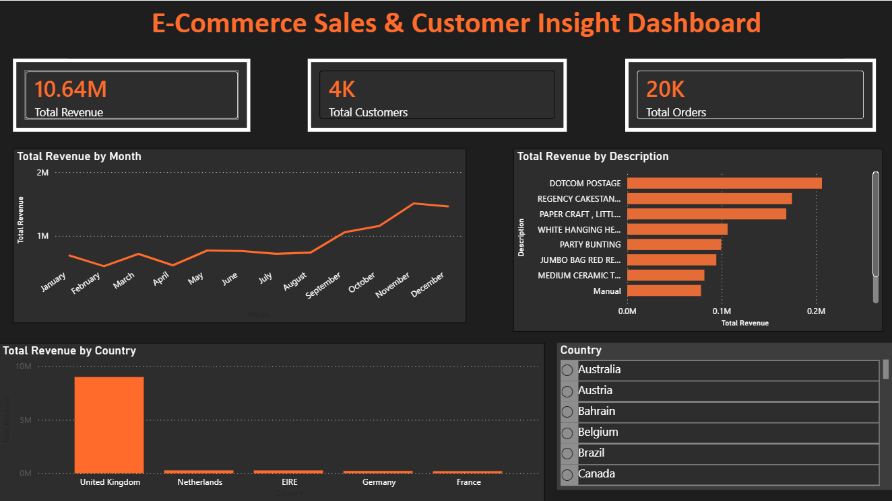

# E-Commerce Sales & Customer Insight Dashboard (Power BI)

A Power BI dashboard analysing 530K cleaned transactions from a UK online gift retailer (Dec 2010 – Dec 2011): revenue, customers and orders, monthly trend, best-selling products and revenue by country, with a country slicer that filters every visual.



## Highlights

- **Data cleaning** — removed 10.6K returns/cancellations and 1.2K zero-price lines from 541,909 raw rows; reproducible with a Python script
- **DAX measures** — revenue with `SUMX`, unique customers and orders with `DISTINCTCOUNT`
- **Interactive report** — KPI cards, monthly trend, product and country rankings, and a country slicer

## KPIs

| Total Revenue | Total Customers | Total Orders |
|---|---|---|
| **£10.64M** | **4,338** | **19,962** |

## Key DAX

```dax
Total Revenue   = SUMX ( data, data[Quantity] * data[UnitPrice] )
Total Customers = DISTINCTCOUNT ( data[CustomerID] )
Total Orders    = DISTINCTCOUNT ( data[InvoiceNo] )
```

All measures: [dax/measures.dax](dax/measures.dax)

## Insights

- **Strong Q4 seasonality** — revenue climbs from September and peaks in **November (£1.51M)**, about three times February's £0.52M, consistent with gift buying before Christmas.
- **The United Kingdom brings 84.6% of revenue** (£9.0M); the Netherlands, EIRE, Germany and France follow at £0.21M–£0.29M each. The business depends heavily on its home market.
- **Top products** — Regency Cakestand 3 Tier (£174K), Paper Craft Little Birdie (£168K) and White Hanging Heart T-Light Holder (£106K). The largest single line, *DOTCOM POSTAGE* (£206K), is a postage charge rather than a product.
- **Order profile** — 19,962 orders from 4,338 identified customers across 38 countries and 3,922 products; average order value is about £533.

## Data cleaning

| Issue | Rows | Action |
|---|---|---|
| Returns / cancelled invoices (`Quantity ≤ 0`) | 10,624 | Removed |
| Zero-price lines | 1,179 | Removed |
| Missing CustomerID | 132,222 | Kept as sales; not counted as customers |

Details and known limitations: [docs/build_guide.md](docs/build_guide.md)

## Repository structure

```
├── ecommerce_dashboard.pbix         Power BI report
├── data/
│   ├── raw/data.csv                 Original Online Retail data (541,909 rows)
│   └── clean/ecommerce_clean.xlsx   Cleaned data used by the report (530,106 rows)
├── dax/measures.dax                 DAX measures
├── docs/build_guide.md              Cleaning, visuals, validation, limitations
├── scripts/clean_data.py            Reproduces the cleaning
├── theme/CustomTheme.json
└── screenshots/
```

## How to open

1. Install [Power BI Desktop](https://powerbi.microsoft.com/desktop/) (free, Windows).
2. Open `ecommerce_dashboard.pbix`.
3. If data does not load: **Transform data → Data source settings → Change Source** → select `data/clean/ecommerce_clean.xlsx` → **Refresh**.

To reproduce the cleaning: `pip install pandas openpyxl` then `python scripts/clean_data.py`.

## Dataset

[Online Retail dataset](https://archive.ics.uci.edu/dataset/352/online+retail) — UCI Machine Learning Repository (Chen, D., 2015), licensed under CC BY 4.0. Transactions of a UK-based, registered non-store online retailer.

## Tools

Power BI Desktop · Power Query · DAX · Excel · Python (pandas)

## Author

**Minhaz Alam Jisan** — MIS / Data Analyst
[LinkedIn](https://www.linkedin.com/in/minhazjisan)
